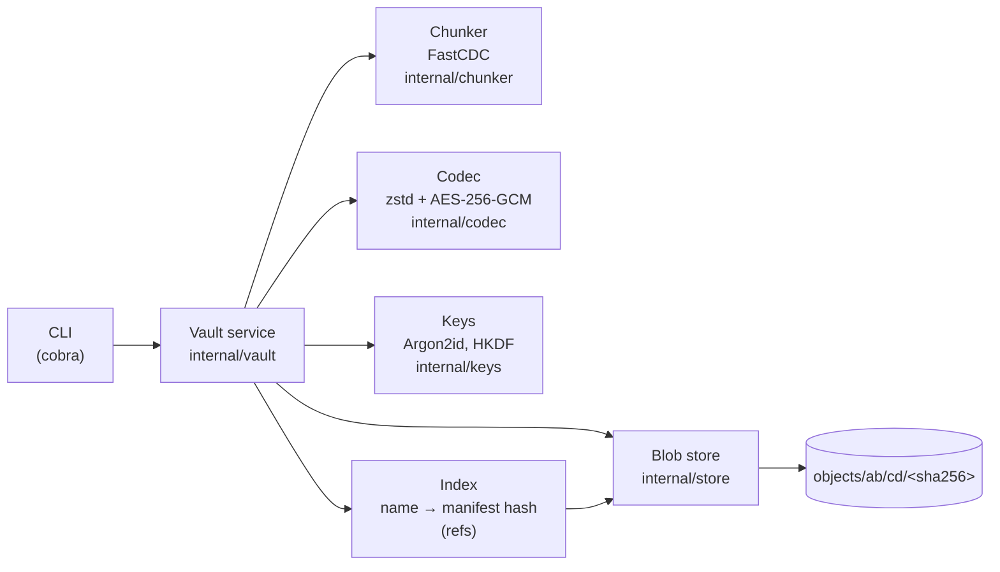
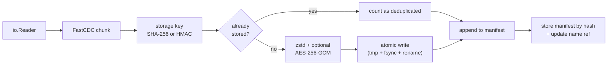

# Chunkvault

Chunkvault is a content-addressable, deduplicating file storage engine written in Go. Files are split into variable-sized chunks with a from-scratch FastCDC content-defined chunker, every chunk is addressed by a hash of its content, and chunks that already exist are never stored twice, so a slightly edited file costs only the few chunks that actually changed. Chunks are compressed with zstd and, optionally, encrypted with AES-256-GCM under a key derived from a passphrase. Each file is described by a JSON manifest that is itself stored as a blob, and reads re-verify every chunk before emitting it.

File data is streamed: `put` and `get` hold only a few chunks (at most 256 KiB each by default, plus their compressed or encrypted copies) in memory at a time, so memory use for the data itself does not grow with file size. A file's manifest is the exception. It is held in memory in full and grows by about 90 bytes per chunk when encoded (about 1.4 MiB per GiB at the default 64 KiB average chunk size). `put` also holds the encoded copy while it writes the manifest, so budget for about twice that at the end of a `put`. The encoded manifest is capped at 1 GiB (before compression and encryption), and `put` fails early with `ErrManifestTooLarge` beyond that.

## Architecture



Write pipeline for `put`:



Repository layout on disk:

```text
.chunkvault/
├── config.json                format version, chunker params, flags, salt, KDF params, wrapped key
├── objects/ab/cd/<key>        chunk and manifest blobs, two-level fan-out
├── refs/<name>                name -> manifest key
├── index.db                   bbolt cache: chunk refcounts and file records (rebuild with reindex)
└── tmp/                       in-flight writes
```

- **`internal/chunker`** – FastCDC with a Gear rolling hash, cut-point skipping below the minimum size and normalized chunking (a stricter mask before the average size, a looser one after). Defaults: 16 KiB min / 64 KiB avg / 256 KiB max. The gear table is generated deterministically so boundaries are stable across builds.
- **`internal/codec`** – turns a plaintext chunk into a blob and back: zstd, then optional AES-256-GCM, behind a small versioned header. Also computes storage keys. See [Blob format](#blob-format).
- **`internal/keys`** – Argon2id key derivation, the wrapped master key and HKDF subkeys. See [Encryption](#encryption).
- **`internal/store`** – the `BlobStore` interface (`Put`, `Get`, `Has`, `Delete`, `List`), a filesystem implementation with atomic writes (temp file, fsync, rename, directory fsync), and the name refs.
- **`internal/vault`** – the service layer: `config.json`, chunk, key, dedupe, encode, store, write manifest, and verified reassembly.

## Quickstart

Requires Go 1.23 or newer.

```sh
make build                                  # builds ./bin/chunkvault
export PATH="$PWD/bin:$PATH"

chunkvault init ./.chunkvault               # create a repository (compressed, not encrypted)
chunkvault init --encrypt ./.chunkvault     # ... or an encrypted one; asks for a passphrase
chunkvault put ./big.iso                    # store a file (name defaults to its base name)
chunkvault put ./big-v2.iso --name big.iso  # re-put: only changed chunks are written
chunkvault get big.iso ./restored.iso       # restore, verifying every chunk hash
chunkvault ls                               # list stored files
chunkvault rm big.iso                       # remove a stored file (chunk data stays until GC)
chunkvault reindex                          # rebuild index.db from the stored files
chunkvault verify [--full]                  # check the repository for missing, corrupt or inconsistent data
chunkvault stats [--json]                   # files, sizes, dedup and compression ratios, reclaimable space
```

Everything else (`put`, `get`, `ls`, `rm`, `reindex`, `verify`, `stats`) works the same for both kinds of repository. Use `--repo <dir>` to point at a repository other than `./.chunkvault`. `put -` reads from stdin (with `--name`) and `get <name> -` writes to stdout.

`rm <name>` deletes the name and releases the chunks it used in the index, but leaves all blobs on disk, also chunks that no file uses any more, so it does not free space until the M3 garbage collector exists. Other files that share chunks with the removed one are unaffected.

`reindex` rebuilds `index.db` from the refs and the manifests they point at, in a temporary file in the repository that is renamed over `index.db` once complete, and prints the number of files and chunks. The index is only a cache of the refs, manifests and blobs, which stay authoritative, so deleting or rebuilding it loses nothing. Run it to repair the index after a crash between writing a file and updating the index (the repository stays readable in the meantime), or to create it for a repository made before the index existed: such a repository fails to open with `repository has no index ... run 'chunkvault reindex'` rather than being rebuilt as a side effect of `get` or `ls`. Do not run other commands on the repository while `reindex` runs.

`verify` checks that every file's manifest and chunks exist and that the index agrees with them: it recomputes the reference count of every chunk from the manifests and compares it, and the stored sizes, with the index, and it looks for index entries without a ref and refs without an index entry. It lists every problem it finds, not just the first, and exits non-zero if there is any. By default chunk blobs are not read, so it is fast. `--full` also reads, decrypts, decompresses and re-hashes every referenced chunk, which finds a blob that was damaged without changing its size, but reads the whole repository. When the only problems are in the index (reference counts, files and refs), it suggests `chunkvault reindex`. A stored size that differs from the blob's is not treated as an index problem, because it usually means the blob was truncated or extended and `reindex` would record the damaged size without reading the blob; `verify` then suggests `chunkvault verify --full` instead, which decodes the chunk.

```text
$ chunkvault verify
Checked 3 files, 412 chunks, 25.3 MiB (default): no problems found

$ chunkvault verify --full
Checked 3 files, 412 chunks, 25.3 MiB (full): 2 problems found
  corrupt_chunk "big.bin" 3f1c...e9: vault: corrupt data: blob 3f1c...e9: codec: plaintext does not match its storage key
  missing_chunk "notes.txt" a07b...42: chunk blob is missing
```

`stats` summarises the index: the number of files, their logical size, the unique chunks they reference and their raw and stored sizes, the deduplication ratio (logical bytes over unique raw bytes), the compression ratio (unique raw bytes over stored bytes) and the chunks no file references any more (left by `rm` or by overwriting a file) with the space the future garbage collector can reclaim. It reads only the index, so run `verify` if you doubt it. `--json` prints the same figures with stable snake_case keys (`files`, `logical_bytes`, `unique_chunks`, `unique_raw_bytes`, `stored_bytes`, `dedup_ratio`, `compression_ratio`, `unreferenced_chunks`, `reclaimable_bytes`). Ratios are 0 in JSON, and `n/a` in the text output, while there is no data.

```text
$ chunkvault stats
Files:                3
Logical size:         57.3 MiB
Unique chunks:        412
Unique raw size:      25.3 MiB
Stored size:          19.8 MiB
Dedup ratio:          2.26x
Compression ratio:    1.28x
Unreferenced chunks:  14
Reclaimable by GC:    900.1 KiB
```

Example: store a 20 MB random file, insert 20 bytes in the middle, store it again:

```text
$ chunkvault put big.bin
Stored "big.bin" (19.1 MiB) in 1.101s
  manifest:      f569ffe1e45b75f95e9a83f4d80c4474f870d4ef66e4f41cef25b1d0edfc4e63
  total chunks:  275
  new chunks:    275 (19.1 MiB)
  deduplicated:  0 chunks (0 B, 0.0%)

$ chunkvault put big2.bin
Stored "big2.bin" (19.1 MiB) in 45ms
  manifest:      767c4ba5f89ec8542e575dc3eb182d766dcf34e46cadc237a7b771ad5c5a9bff
  total chunks:  275
  new chunks:    1 (53.2 KiB)
  deduplicated:  274 chunks (19.0 MiB, 99.7%)
```

## Encrypted repositories

```sh
chunkvault init --encrypt ./.chunkvault
Passphrase:
Confirm passphrase:
```

When stdin is a terminal, `init --encrypt` asks for the passphrase twice without echo (via `golang.org/x/term`), and every later command that opens the repository asks once. Otherwise, or whenever it is set, the `CHUNKVAULT_PASSPHRASE` environment variable is used, which suits scripts and CI. If stdin is not a terminal and the variable is unset, the command fails instead of reading a passphrase from piped data, so `put -` cannot accidentally swallow its own input as the passphrase. A wrong passphrase fails with `wrong passphrase`.

```sh
export CHUNKVAULT_PASSPHRASE='correct horse battery staple'
chunkvault init --encrypt ./.chunkvault
chunkvault put ./notes.txt
chunkvault get notes.txt -
```

**The passphrase cannot be recovered.** It is never stored. Lose it and the data is gone. Whether a repository is encrypted is fixed at `init`; there is no command to convert one.

Repositories created by the M1 release have no `config.json`. They fail to open with a message to re-init; there is no migration, because M1 blobs are raw and unversioned.

## Blob format

Every object in `objects/` (chunks and manifests alike) is a blob with a 6-byte header:

```text
offset  size  field
0       4     magic "CVB\x01"
4       1     format version (1)
5       1     flags: 0x01 zstd compressed, 0x02 AES-256-GCM encrypted
6       12    random nonce (only if encrypted)
...     n     payload
```

The payload is the chunk, zstd-compressed if that made it smaller (a chunk that does not shrink is stored raw and the flag is left clear), then, if encrypted, AES-256-GCM ciphertext followed by the 16-byte tag. Unknown versions or flags are rejected, and a blob never grows by more than the header, nonce and tag.

Blobs are filed under a 32-byte **storage key**:

| Repository  | Storage key                                   |
| ----------- | --------------------------------------------- |
| unencrypted | `SHA-256(plaintext)`                          |
| encrypted   | `HMAC-SHA-256(macKey, plaintext)`             |

Reading a blob checks the GCM tag (if encrypted), then recomputes the storage key from the decoded plaintext and compares it with the key the blob was read from, so a blob can only decode to the content it is named for. Decoding is also bounded: a blob or its decompressed output larger than the chunk size recorded in the manifest is rejected, which stops a decompression bomb.

## Encryption

```text
passphrase --Argon2id(salt, t=3, m=64 MiB, p=4)--> KEK (32 bytes)
KEK --AES-256-GCM--> wrapped master key (random, 32 bytes)      stored in config.json
master key --HKDF-SHA-256, info "chunkvault/v1/enc"--> encKey   AES-256-GCM for blobs
master key --HKDF-SHA-256, info "chunkvault/v1/mac"--> macKey   HMAC-SHA-256 for storage keys
```

- `config.json` holds the salt, the KDF parameters and the wrapped master key, and nothing else secret. The passphrase, the KEK, the master key and the subkeys exist only in memory while a command runs, and are wiped afterwards. The KDF parameters are stored so they can be raised later without breaking old repositories; parameters read from a config are range-checked so a corrupt file cannot demand unbounded memory.
- The master key is random and only wrapped by the passphrase-derived key, so a passphrase change would only rewrite `config.json`. (There is no `passwd` command yet.)
- Each blob has a fresh random 96-bit nonce. The GCM additional data is the header followed by the blob's storage key, so the flags are authenticated and a valid blob cannot be copied under another key.
- Storage keys are keyed (HMAC), not plain hashes. Without the key, someone who holds the repository cannot test whether a known file or chunk is in it (a confirmation-of-file attack) or tell whether two chunks are equal other than by seeing that they share a key.
- Deduplication still works in an encrypted repository, because equal chunks get equal storage keys under the same key. It does not work across repositories, which have different keys.

### Threat model

Protected, against someone who can read the repository directory but does not know the passphrase:

- **Content** of chunks and manifests, including file names *inside* manifests, sizes and the chunk list.
- **Integrity**: modifying, truncating, swapping or replacing a blob makes `get` fail. The GCM tag covers the header and storage key, and the plaintext hash is re-checked.
- **Chunk equality and known-file tests**, as above.
- The passphrase and keys are not written to disk.

Not protected:

- **File names are not encrypted yet.** `refs/<name>` is a plain file whose name is the (escaped) name you gave to `put`, so the set of names, and when they were written, is visible.
- **Sizes and counts are visible**: the number of blobs, each blob's approximate size (the compressed chunk size plus 34 bytes), and therefore roughly how many chunks and how much data there is. Chunk sizes follow the content-defined boundaries, and compressed sizes leak a little about how compressible the data is.
- **Deduplication is observable** to someone who sees the repository over time: a `put` that adds few blobs reveals that its content largely already existed.
- **Which refs share a manifest** is visible, since a ref holds the plain key of its manifest.
- **Rollback and deletion**: an attacker with write access can delete blobs or restore an older copy of the repository (or a ref) and `get` cannot tell an old consistent state from the current one. Deleting or damaging data is detected on read, but not prevented.
- Anything on the machine that runs chunkvault: a compromised host sees the passphrase and plaintext. Argon2id slows brute force but a weak passphrase is still weak.
- **The unencrypted mode** protects nothing: blobs are only compressed, and keys are plain SHA-256. It still detects corruption.

## Development

```sh
make test     # go test -race ./...
make cover    # tests with coverage profile and per-function summary
make lint     # golangci-lint (must be installed separately)
make bench    # chunker benchmarks, reports MB/s
```

The chunker is covered by [rapid](https://pkg.go.dev/pgregory.net/rapid) property tests: concatenated chunks equal the input, chunk sizes respect min/max (except a smaller final chunk), chunking is deterministic, and inserting bytes in the middle of a large input leaves nearly all surrounding chunks unchanged. The codec has property tests for round trips and tamper detection, and the vault has property tests that arbitrary data round-trips and dedups in both modes. The CLI has end-to-end tests for both modes, including deduplication in an encrypted repository and a tampered blob making `get` fail.

### Benchmarks

Chunking throughput with default parameters on random data (Intel Xeon Platinum 8581C @ 2.10 GHz, 2 vCPUs, Go 1.22, `go test -bench`; single-threaded, in-memory source, excludes hashing and disk I/O):

| Benchmark                   | Throughput  | Allocs/op |
| --------------------------- | ----------- | --------- |
| `default/1MiB`              | ~1360 MB/s  | 3         |
| `default/16MiB`             | ~1450 MB/s  | 3         |
| `default/64MiB`             | ~1385 MB/s  | 3         |
| `small/16MiB` (2/8/32 KiB)  | ~1560 MB/s  | 3         |

Numbers vary by machine; run `make bench` for your own. End-to-end `put` throughput is dominated by SHA-256 and fsync.

## CI

`.gitlab-ci.yml` runs `golangci-lint`, a `gofmt` check, `go mod tidy -diff`, `go test -race` with a coverage profile (coverage percentage and a Cobertura report for MR diff coverage), GitLab SAST, and builds `linux/amd64` and `linux/arm64` binaries as job artifacts.

## Roadmap

- [x] **M1** – Module scaffold, FastCDC chunker, filesystem blob store, vault service, CLI (`init`, `put`, `get`, `ls`), CI.
- [x] **M2a** – zstd compression; AES-256-GCM encryption with Argon2id key derivation and HKDF subkeys; versioned blob format and `config.json`; `init --encrypt`.
- [x] **M2b** – bbolt index; `rm`, `reindex`, `verify` and `stats` commands.
- [ ] **M2c** – parallel worker pool; end-to-end benchmarks; SAST cleanup.
- [ ] **M3** – Mark-and-sweep garbage collection; S3/MinIO backend; REST API (chi); docker-compose.
- [ ] **M4** – Snapshots; benchmark results on a real dataset; `docs/design.md`; v1.0.0 release.
