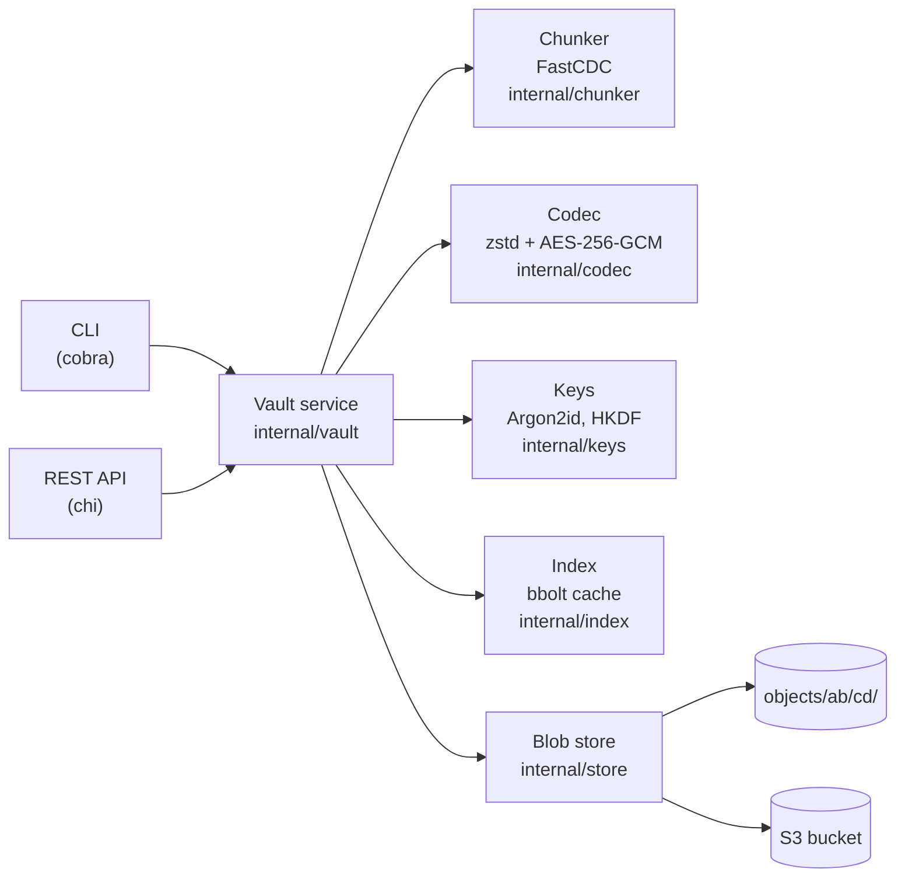
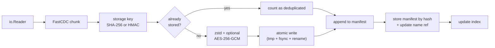

# ChunkVault Design Document

## Overview

ChunkVault is a content-addressable, deduplicating file storage engine. Files are split into variable-sized chunks by a FastCDC content-defined chunker. Each chunk is addressed by a hash of its content, so chunks that already exist are never stored twice. Chunks are compressed with zstd and optionally encrypted with AES-256-GCM. Each file is described by a JSON manifest stored as a blob, and reads re-verify every chunk hash before emitting data.

The core invariant: a chunk key is derived from the chunk's plaintext, so equal content always maps to the same key within a repository. Reading a blob recomputes the key from the decoded plaintext and asserts equality, detecting corruption or tampering.

## Architecture



### Write pipeline (`put`)



### Repository layout

```text
<repo>/
├── config.json               format version, chunker params, compression/encryption flags,
│                             salt, KDF params, wrapped master key
├── objects/ab/cd/<key>       chunk and manifest blobs (two-level fan-out)
├── refs/<name>               name → manifest key (one file per stored name)
├── refs/.snapshots/<tag>     snapshot tag → snapshot blob key
├── index.db                  bbolt cache: chunk refcounts and file records
└── tmp/                      in-flight writes (cleaned up on completion)
```

### Packages

| Package | Role |
|---------|------|
| `internal/chunker` | FastCDC with Gear rolling hash. Defaults: 16 KiB min / 64 KiB avg / 256 KiB max. |
| `internal/codec` | zstd compression + AES-256-GCM encryption behind a versioned header. |
| `internal/keys` | Argon2id KDF, wrapped master key, HKDF subkey derivation. |
| `internal/store` | `BlobStore` interface, filesystem implementation, S3/MinIO implementation, name refs. |
| `internal/index` | bbolt-backed chunk refcount and file record cache. |
| `internal/vault` | Service layer: Put, Get, List, Remove, Reindex, Verify, Stats, GC, Snapshots. |
| `internal/api` | chi-based REST API wrapping vault operations. |
| `cmd/chunkvault` | CLI (cobra). |
| `cmd/chunkvaultd` | REST API daemon. |

## Blob format

Every object in `objects/` (chunks and manifests alike) uses this layout:

```text
offset  size   field
0       4      magic "CVB\x01"
4       1      format version (1)
5       1      flags: 0x01 zstd compressed, 0x02 AES-256-GCM encrypted
6       12     random nonce (encrypted repos only)
18+     n      payload: compressed and/or encrypted chunk data
last    16     GCM authentication tag (encrypted repos only)
```

The payload is the chunk, zstd-compressed if that reduces size (flag cleared if not), then, if encrypted, AES-256-GCM ciphertext. The GCM additional data is `header || storage_key`, so the flags are authenticated and a valid blob cannot be moved to a different key.

Blobs are filed under a 32-byte **storage key**:

| Repository  | Storage key                        |
|-------------|-------------------------------------|
| Unencrypted | `SHA-256(plaintext)`               |
| Encrypted   | `HMAC-SHA-256(macKey, plaintext)`  |

Reading a blob checks the GCM tag, then recomputes the storage key from the decoded plaintext and asserts equality. A blob can only decode to the content it was written from.

## Encryption

```text
passphrase --Argon2id(salt, t=3, m=64 MiB, p=4)--> KEK (32 bytes)
KEK --AES-256-GCM--> wrapped master key (random, 32 bytes)   stored in config.json
master key --HKDF-SHA-256, info "chunkvault/v1/enc"--> encKey  AES-256-GCM for blobs
master key --HKDF-SHA-256, info "chunkvault/v1/mac"--> macKey  HMAC-SHA-256 for storage keys
```

Key lifecycle:
- `config.json` stores: salt, KDF parameters, AES-GCM-wrapped master key. Nothing else secret.
- Passphrase, KEK, master key, and subkeys exist only in memory during command execution and are wiped after use.
- KDF parameters are stored so they can be raised without breaking old repositories.
- Each blob has a fresh 96-bit random nonce. The GCM tag covers the blob header and storage key.
- Storage keys are keyed (HMAC), not plain SHA-256. An observer with the repository but not the passphrase cannot test whether a known file exists (confirmation-of-file attack), or tell whether two chunks are equal without seeing identical storage keys.

## Threat model

### Protected

- **Content** of chunks and manifests, including file content, file sizes, and chunk boundaries.
- **File names inside manifests** are encrypted along with the manifest blob.
- **Integrity**: modifying, truncating, swapping or replacing a blob causes `get` to fail. The GCM tag covers the header and storage key; plaintext hash is rechecked after decode.
- **Chunk equality tests**: storage keys are HMAC-keyed, so equal chunks cannot be identified without the key.

### Not protected

- **Ref names** (`refs/<name>`) are plain files. The set of stored names and their modification times are visible to anyone with filesystem access.
- **Blob counts and sizes**: the number of blobs, each blob's approximate size (compressed chunk + 34-byte overhead), and therefore rough data volume and compressibility are visible.
- **Deduplication is observable** over time: a `put` that writes few new blobs reveals that the content largely already existed.
- **Snapshot tags** are visible (stored as ref file names under `refs/.snapshots/`).
- **Rollback by an attacker with write access**: deleting blobs or restoring an old repository state cannot be detected by `get` on a consistent old snapshot. Data deletion/damage is detected on read.
- **Host compromise**: a compromised host sees the passphrase and plaintext in memory. Argon2id slows offline brute force on a stolen repository but a weak passphrase is still weak.

## Crash consistency

The blob store, manifests, and refs are the source of truth. The index is a cache.

Write order for `put`:
1. Write all chunk blobs.
2. Write the manifest blob.
3. Write the ref (`refs/<name>` → manifest key).
4. Update the index.

A crash between steps 3 and 4 leaves a repository whose blobs and refs are consistent but whose index is stale. `reindex` repairs it. No data is lost. `get` and `ls` do not consult the index for correctness — only for performance.

## Snapshots

A snapshot is a manifest-of-manifests: a JSON blob stored through the codec (encrypted in encrypted repos) in the blob store, with a ref in `refs/.snapshots/<tag>`. It records each stored file's name and manifest key at the time of the snapshot.

`RestoreFromSnapshot` is non-destructive: it restores files whose current manifest key differs from the snapshot's record, and leaves files not in the snapshot untouched. It is a restore, not a rollback — files added after the snapshot are not deleted.

## Benchmarks

Measured on Windows 11, 13th Gen Intel Core i7-13620H (16 logical cores), NVMe SSD, Go 1.24. All numbers from `go test -bench -benchtime=3s`.

### Chunker throughput (in-memory, single-threaded)

| Benchmark | Input | Throughput | Allocs/op |
|-----------|-------|-----------|-----------|
| `default/1MiB` | 1 MiB random | ~953 MB/s | 3 |
| `default/16MiB` | 16 MiB random | ~468 MB/s | 3 |
| `default/64MiB` | 64 MiB random | ~457 MB/s | 3 |
| `small/16MiB` (2/8/32 KiB) | 16 MiB random | ~453 MB/s | 3 |

### End-to-end (put + get, local filesystem, random data)

| Benchmark | Description | Throughput |
|-----------|-------------|-----------|
| `BenchmarkPutGetRoundtrip` | 20 MiB put then get | ~2.8 MB/s |
| `BenchmarkPutDeduplicated` | 20 MiB already stored (second put) | ~99 MB/s |
| `BenchmarkPutParallel` | 64 MiB put, 4 workers | ~18 MB/s |

The end-to-end put throughput (~2.8 MB/s) is dominated by fsync on Windows — Linux benchmarks run significantly faster. The deduplication path (~99 MB/s) confirms that re-putting identical content pays only the manifest overhead. Chunker throughput does not translate directly to end-to-end throughput: SHA-256 and disk I/O dominate.
